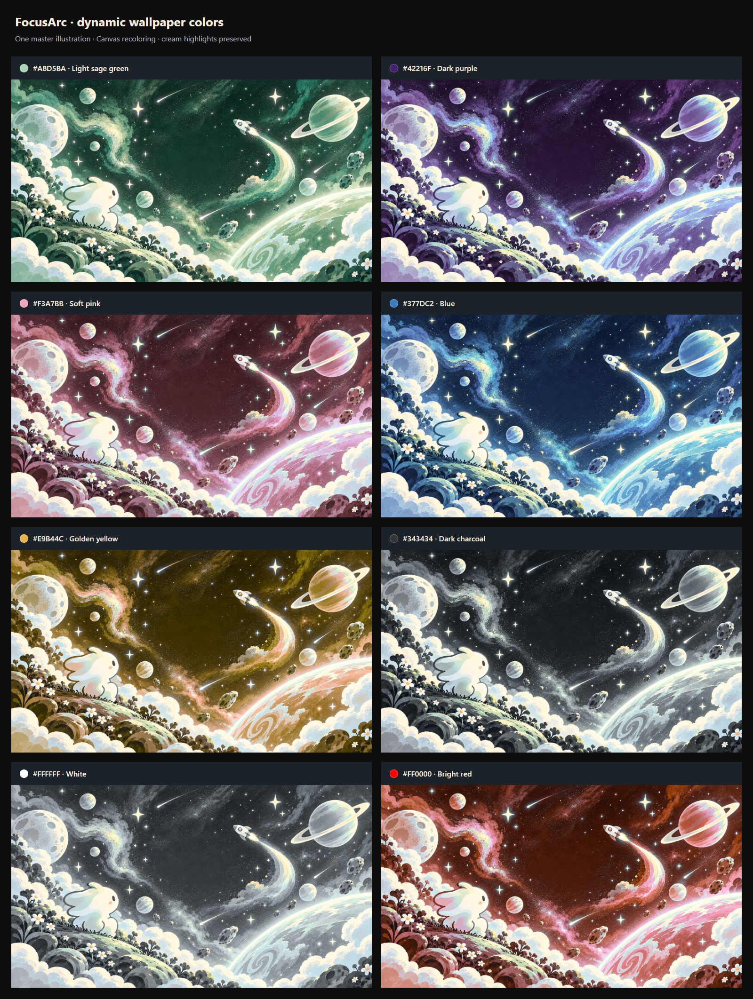

# Dynamic HEX screensaver recoloring

Each timer's exact six-digit HEX derives a palette for the selected illustration. The engine now supports [all five supplied wallpapers with stable study selection](screensaver-wallpapers.md). Preset-color selection and CSS hue filters have been removed. Timer state, daily elapsed time, controls, activation, dismissal and persistence still belong to the existing shared timer runtime.



## Color mapping

`frontend/src/utils/screensaverRecolor.ts` contains the pure pixel engine:

1. Normalize HEX and decode sRGB. Invalid input uses `#5E6AD2`.
2. Prepare the source once per worker lifetime: convert pixels to Oklab and record their lightness, two chroma channels and a soft recoloring weight. Derive the master artwork's average cool hue from its pixels.
3. Derive the target hue, chroma and lightness from the full HEX. Rotate the source chroma around the target hue, preserving the source's local color variation. Smoothly compress high saturation so vivid colors stay painterly and continue to differ from each other.
4. Apply a restrained target-lightness adjustment while retaining each pixel's lightness detail. Dark colors deepen the scene; light colors lift it without washing out the night sky. Achromatic colors produce restrained neutral scenes with distinct brightness.
5. Blend through a color-based soft mask. Warm cream stars, highlights and important neutrals stay unchanged; cool atmospheric pixels adapt. The character's cream body is protected, while some cool shadows/outlines adapt naturally. There are no hand-drawn regions or coordinate masks.
6. For colors outside sRGB, reduce chroma at the same hue/lightness instead of clipping channels into flat patches. Encode the final pixels back to sRGB.

The Oklab conversion matrices follow [Björn Ottosson's public-domain reference](https://bottosson.github.io/posts/oklab/). The artistic mapping, masking, lightness adjustment and gamut compression are project-specific.

## Rendering and file map

- `frontend/public/screensaver/master-screensaver*.png`: unmodified copies of the five supplied clean masters, centralized in `utils/screensaverWallpapers.ts`. All five use this same mapper without image-specific processing profiles.
- `frontend/src/workers/screensaver.worker.ts`: fetch/decode the master, prepare its pixel channels, render through OffscreenCanvas and return a PNG Blob. Source decoding/preparation is shared between colors.
- `frontend/src/utils/screensaverRenderer.ts`: one shared module worker, concurrent-request deduplication, source/normalized-HEX cache keys and an eight-entry Blob LRU. A 20-second timeout or worker crash releases jobs safely. Idle workers terminate after 15 seconds, releasing source buffers. No object URLs or DOM nodes are cached.
- `frontend/src/components/ScreensaverWallpaper.tsx`: decode a finished Blob, replace the visible Canvas in one task and close the ImageBitmap. Older async results cannot overwrite newer colors or an unmounted/disabled view. Keep the last complete frame during an in-place HEX update; on failure retain it. A new activation waits in the normal timer view until the exact source/HEX frame is ready; unrecolored masters are never shown as an entrance fallback. See [readiness and entrance transitions](screensaver-transitions.md).
- `Screensaver.tsx` supplies the existing active timer color. `screensaver.css` scales the Canvas using `object-fit: cover`, keeping timer text and controls in their independent layer. Timer ticks and window resizes do not process pixels.
- `frontend/src/utils/screensaverTheme.ts` was removed. No dependencies or backend changes were added.

## Verification on 2026-10-26

- **102 frontend tests passed**, including pixel preservation, eight distinct outputs, same-family differences, shading order, cache deduplication/eviction, idle shutdown, crashes/timeouts, source changes, stale async results, bitmap disposal and fallback.
- TypeScript/Vite production build passed and emitted the module-worker asset.
- Built-app smoke test on localhost:5176 with an isolated mock API: automatic entry displayed the bundled worker's 1672×941 sage frame, with no CSS filter and no browser errors.
- Real Chrome comparison through the production worker: all eight requested colors produced different image hashes; an additional dark sage differed from light sage. **192,771 independently identified cream-highlight pixels remained byte-identical in every image.** Inspected the complete comparison and 900×700/narrow timer views.
- Representative comparison run: **176–389ms** per uncached full-resolution image including decode, verification and display; cache reads **0–0.1ms**. The 25ms main-thread probe's largest gap was **46ms**, including test instrumentation. Nine color jobs ran; the idle worker terminated once as expected. These timings are observations on this machine, not cross-device guarantees.
- Real local API, two independent Chrome profiles in Tokyo/Los Angeles: automatic entry, shared time, persisted +10/−5, pause/resume, Exit/Escape, refresh, remote HEX updates without session reset, reporting routes, offline/reconnect, reduced motion, 320×568 and 900×400 passed with **zero browser errors**. Worker counters stayed unchanged across timer ticks, adjustments and viewport resizing. A third profile with Worker disabled displayed the clean master and retained working timer controls.
- Independent code review found no additional actionable runtime issues; source/HEX readiness tracking was verified after correction.

## Repeating the checks

With Vite serving the frontend on localhost:5175, generate the comparison without an account or API:

```powershell
playwright-cli.cmd -s=recolor open http://localhost:5175 --browser=chrome
playwright-cli.cmd -s=recolor run-code --filename=scripts/verify_screensaver_recolor.js
```

The script writes `.deployment-private/screensaver-color-comparison.png`, checks real-image highlight preservation, measures cache/render timing and verifies idle shutdown. The committed preview is `docs/screenshots/screensaver-color-comparison.png`.

Run `scripts/verify_screensaver.js` against the disposable local API on port 8002 for the actual timer/browser flow, as described in [screensaver.md](screensaver.md).

## Limits and future extension

The mapping is tuned to this cool-blue master. A substantially different source illustration may need mask tuning. Protected warm details retain their original colors; extreme targets are deliberately compressed to preserve the illustration. Nearby HEX values may appear very similar. Unsupported Canvas/worker environments show the original master instead of a recolored scene.

The artwork remains a static, cached frame. [Scene-specific animation overlays](screensaver-animations.md) now sit above it without changing pixel processing or timer ownership. They follow the source and HEX reported by the committed visible frame.
