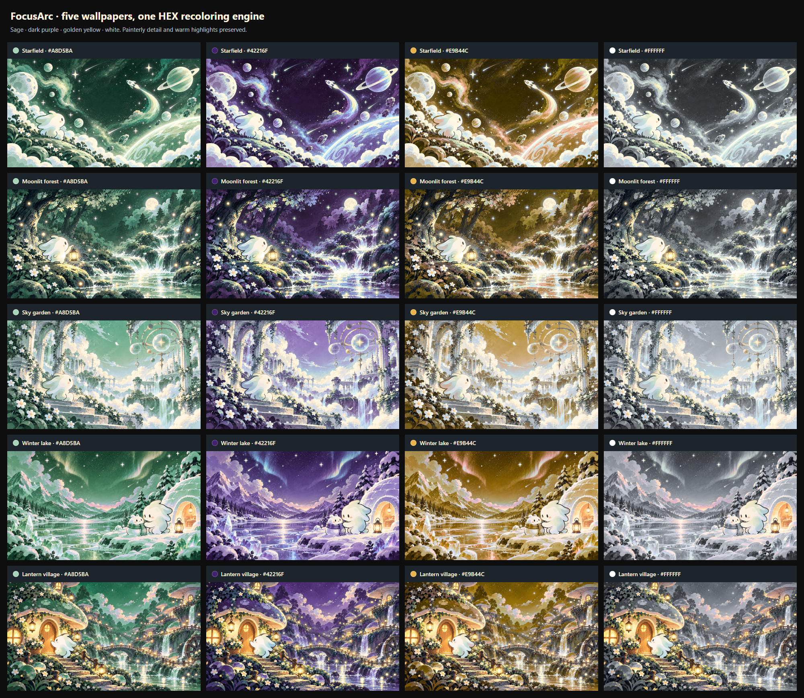
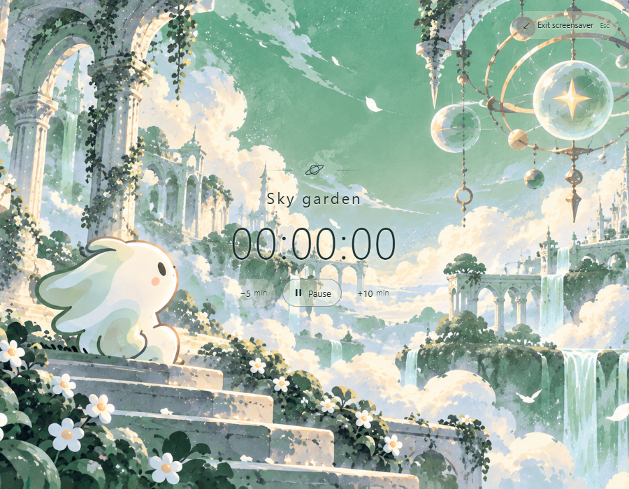

# Five screensavers with stable random selection

All five supplied illustrations use the existing selective Canvas/Oklab recoloring engine. The active timer's exact HEX still supplies hue, chroma and lightness; the images keep their painted texture, shading and protected cream details. No image-specific pixel-processing parameters were needed after visual validation.



## Study boundaries

The user clarified that Play on the same timer is a resume, even though the backend saves a new session record. Artwork grouping is separate presentation state:

| Action | Wallpaper behavior |
|---|---|
| First timer activation | Uniform choice among all five |
| Pause, then Play on the same timer | Keep the current image |
| Exit, re-entry, timer ticks, HEX edits or resize | Keep the image; recolor only when HEX changes |
| Start a different timer | Choose uniformly among the other four |
| Successful reset of cycle counters in this app | Invalidate grouping; choose again on next activation |
| New Toronto study day | Begin a new choice when a timer is active or starts |
| Refresh | Restore the saved image; the normal interface stays visible until the next activation |

Excluding the previous image prevents consecutive repeats. Each remaining image has the same probability, with symmetric long-run chances across all five. Randomness runs at study boundaries only, including under React StrictMode.

Choices are stored under the account's `screensaverWallpaper` browser-storage key. They are local presentation preferences, not server-synchronized artwork assignments; separate devices may choose different images. Shared timers, HEX colors and saved sessions remain authoritative on the server. Reset grouping is signaled by the successful reset command in the app that invokes it. When storage is unavailable, the current mounted app still keeps its choice; refresh persistence is best-effort.

## File map and data flow

- `frontend/src/utils/screensaverWallpapers.ts`: centralized stable IDs, labels, source paths and overlay ink; `chooseScreensaverWallpaper` samples the eligible list. Expand the catalog and add a clean source image to support more artwork.
- `frontend/public/screensaver/master-screensaver*.png`: unmodified copies of all five supplied 1672×941 images: Starfield, Moonlit forest, Sky garden, Winter lake and Lantern village. Original root files remain untouched.
- `frontend/src/hooks/useScreensaverWallpaper.ts`: reads/validates account-scoped selection, preserves same-timer grouping and chooses at switch/day/reset boundaries. A ref is updated before React state to prevent StrictMode effect replay from drawing twice.
- `frontend/src/context/TimerRuntimeContext.tsx`: increments a local `wallpaperResetRevision` only after `resetTotals` succeeds. The reset's response and server/session behavior are unchanged.
- `frontend/src/components/MainLayout.tsx`: supplies shared active session/day/reset revision to the selection hook, then passes the selected definition to `Screensaver`.
- `Screensaver.tsx`, `ScreensaverWallpaper.tsx` and `screensaver.css`: pass source and HEX through the existing worker/cache. Overlay ink follows the actual visible Canvas or raw fallback before paint. Sky garden uses dark ink and a light backing for its bright sky; the other scenes retain cream ink. Positions, controls and automatic view activation are unchanged.
- `screensaverRecolor.ts`, `screensaverRenderer.ts` and the worker retain the shared mapping, eight-entry source+HEX Blob cache, async race protection and idle cleanup. The master path is now centralized in the catalog and re-exported for compatibility. No per-image mapping branches or new dependencies were added.

The previous complete frame remains visible while another is prepared. Cached same-image/same-HEX resumes need no new pixel work. Cold source loads remain asynchronous; their first preparation/encode takes measurable time rather than blocking the timer UI.

## Validation on 2026-10-26

- **112 frontend tests passed**; TypeScript/Vite production build passed.
- Twenty real-worker outputs (five images × sage `#A8D5BA`, dark purple `#42216F`, gold `#E9B44C`, white `#FFFFFF`) were generated and visually inspected. Four distinct image hashes per source and normalized source+HEX cache reuse verified. Sampled cream pixels remained byte-identical per image: **192,771 / 149,348 / 326,496 / 159,369 / 184,269**.
- Inspected all five overlays at 900×700, including white/neutral and dark-purple variants, plus narrow layouts. Sky garden's dark overlay preserves readability without a large panel. Its visible-source callback also fixes initial-fallback/retained-frame contrast races.
- Real local API: each of the five first-choice intervals selected its expected scene in an isolated profile. Pause/resume, Exit/refresh/re-entry, stored artwork, live HEX edits, unchanged running-session identity during color changes, and 320×568 controls passed. Timer switches and successful resets excluded the previous image. **Zero browser errors.**
- Existing two-profile timer checks passed: shared activation/time, persisted +10/−5, normal refresh/dismissal, reporting routes, offline/reconnect, reduced motion, no work on ticks/resize, and functional selected-artwork fallback with Worker disabled.
- Production build smoke-tested all five assets and the bundled worker at localhost:5176 with an isolated mock API: 1672×941 canvases, expected overlay ink, no CSS filters and no browser errors.
- Independent review found and re-reviewed the fallback/ink race; no outstanding findings remained. Full tests and browser verification ran in the parent environment.

## Repeatable checks

With Vite on localhost:5175:

```powershell
playwright-cli.cmd -s=wallpapers open http://localhost:5175 --browser=chrome
playwright-cli.cmd -s=wallpapers run-code --filename=scripts/verify_screensaver_wallpapers.js
```

This generates `.deployment-private/screensaver-wallpapers-comparison.png` without an API. For real timer/selection flows, start the disposable local API on port 8002 and run `scripts/verify_screensaver_rotation.js` or the existing `scripts/verify_screensaver.js`. They create disposable accounts and never target production. Keep source screenshots/reports in the ignored `.deployment-private/` directory.



The feature has three commits: catalog/artwork comparison; study selection and overlay integration; final browser checks and documentation. No backend, schema, dependency or animation changes, and no production deployment.
