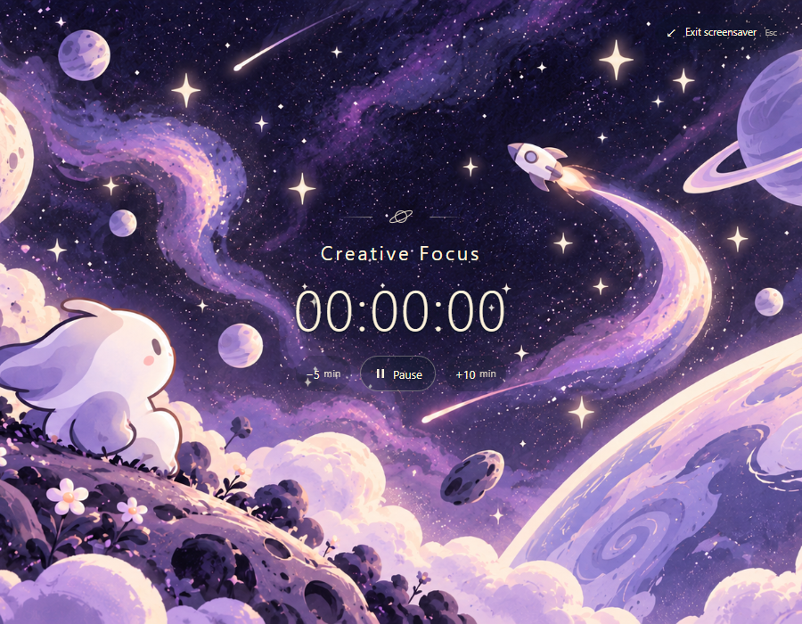

# Timer screensaver

Starting or resuming a timer opens a full-viewport illustrated space scene. A newly synchronized session from another device opens it too. Pause returns to the normal interface. Exit or Escape returns without stopping the timer and stays dismissed for that session. Refresh always starts in the normal interface, including when an account timer is already running.



## Integration and files

- `frontend/src/hooks/useScreensaverMode.ts`: tracks the dismissed session ID in React state. The first loaded session is suppressed; a different active ID opens the view. View activation is never persisted; artwork selection has its own account-scoped preference and no separate timer clock.
- `frontend/src/components/MainLayout.tsx`: derives the active timer and Toronto daily total from `TimerRuntimeContext`, renders the screensaver above the mounted route, and makes the normal interface inert while open. Keeping the route mounted preserves its UI state.
- `frontend/src/components/Screensaver.tsx` and `screensaver.css`: dynamic name/time, always-visible Pause/−5/+10, Exit, shared action errors, focus restoration/trapping, offline focus recovery and reduced-motion transitions. Pause calls the existing `stopTimer`; resume remains the normal Play action after pausing. The app has no separate active Stop action.
- `frontend/src/utils/screensaverRecolor.ts`, `screensaverRenderer.ts`, `workers/screensaver.worker.ts` and `components/ScreensaverWallpaper.tsx`: selective Oklab/Canvas recoloring of the supplied master, derived from exact timer HEX; worker processing, bounded cache and clean-master fallback. See [the color engine, comparison and performance notes](screensaver-recoloring.md).
- `frontend/src/utils/screensaverWallpapers.ts`, `hooks/useScreensaverWallpaper.ts` and `public/screensaver/master-screensaver*.png`: five supplied artworks, shared recoloring and uniform selection excluding the previous image. Every start/resume chooses again; ticks, HEX edits, day changes and ordinary rerenders preserve the image. See [wallpaper selection and comparison](screensaver-wallpapers.md). All timer UI remains dynamic.
- `frontend/tests/screensaver-*.test.ts*`: activation, dismissal, refresh, pixel mapping, cache/lifecycle, controls, errors and keyboard regressions. Existing `release.test.tsx` pins the three fake-clock polling tests inside their hardcoded fixture day, preventing accidental midnight refreshes.
- `scripts/verify_screensaver.js`: repeatable local two-profile browser checks. `scripts/verify_cross_device_sync.js` now exits the default screensaver before its existing normal-view checks.

No dependencies, backend changes, schema changes or migrations were added. The artwork layer is static and separate from the dynamic UI, allowing later artwork animation without moving timer ownership.

## Verification

On 2026-10-26:

- `cd frontend; npm.cmd test -- --reporter=dot`: **112 tests passed**.
- `cd frontend; npm.cmd run build`: TypeScript and Vite production build passed.
- Real Chrome, independent profiles in Tokyo and Los Angeles: local/remote activation; +10/−5 persisted in the same session; manual Exit across polls and timer browsing; refresh without reopening/duplicating; pause and resume; Escape; remote HEX edits without resetting the timer; maximum-length timer name at 320×568 and 900×400; effectively instant reduced motion; offline focus recovery and Escape from document focus; reconnect without reopening; History, Schedule and Stats while the timer continues. **No browser errors.** Inspected blue/orange/purple 900×700 and narrow/short screenshots.
- Updated cross-device script with `skip_idle=1`: **0-second clock difference**, start propagation 1,984ms and History propagation 2,145ms; both-direction History/Schedule edits, fixed session ends, stale command rejection, daily totals after cycle reset, sleeping observer safety and cookie/account isolation passed. The existing five-minute server inactivity policy is unchanged; this frontend change did not rerun the five-minute wait.
- Independent code review found a Chromium focus-loss issue when controls become disabled. Fixed by focusing Exit and handling keyboard events on the document only while open; the real offline browser regression passed after the fix.
- Canvas follow-up: eight-color comparison, exact cream preservation, cache/idle cleanup, no processing on ticks/resize, and functional timer controls with Worker disabled all passed. See [recoloring verification](screensaver-recoloring.md).
- Five-wallpaper follow-up: twenty-color comparison, all five overlay/selection flows, same-timer resume/refresh persistence, timer-switch/reset boundaries and production assets verified. See [wallpaper verification](screensaver-wallpapers.md).

## Repeating browser checks

Run against the disposable local API on `http://localhost:8002/api` and frontend on `http://localhost:5175`, with the existing local QA database. The scripts refuse other frontend origins.

```powershell
playwright-cli.cmd -s=screensaver open http://localhost:5175/timers --browser=chrome
playwright-cli.cmd -s=screensaver run-code --filename=scripts/verify_screensaver.js
playwright-cli.cmd -s=screensaver goto 'http://localhost:5175/timers?skip_idle=1'
playwright-cli.cmd -s=screensaver run-code --filename=scripts/verify_cross_device_sync.js
```

The screensaver script creates disposable accounts and timers. When local registration is rate limited, it can reuse a previously created account by navigating to `/timers?qa_account=screensaver-qa-...` first. It archives that disposable account's previous timers before creating fresh ones. Screenshots and reports remain under ignored `.deployment-private/`.

## Review

The initial screensaver was committed in three stages. Dynamic Canvas recoloring is a separate three-stage follow-up on `feat/dynamic-screensaver-colors`: pixel engine/master, worker/view integration, then comparison/browser verification. No production deployment was performed.
